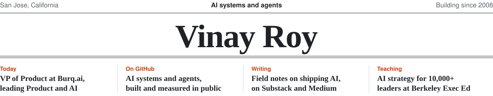
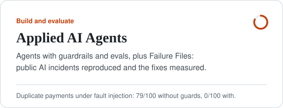
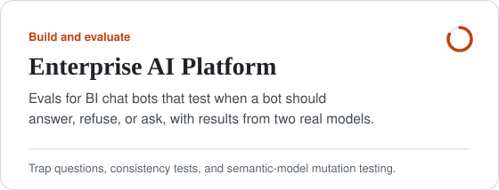
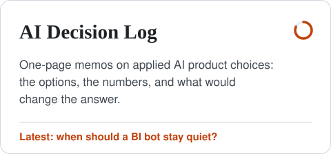
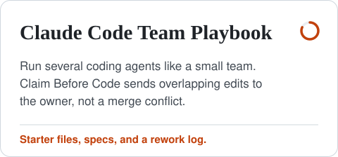
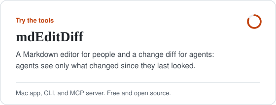
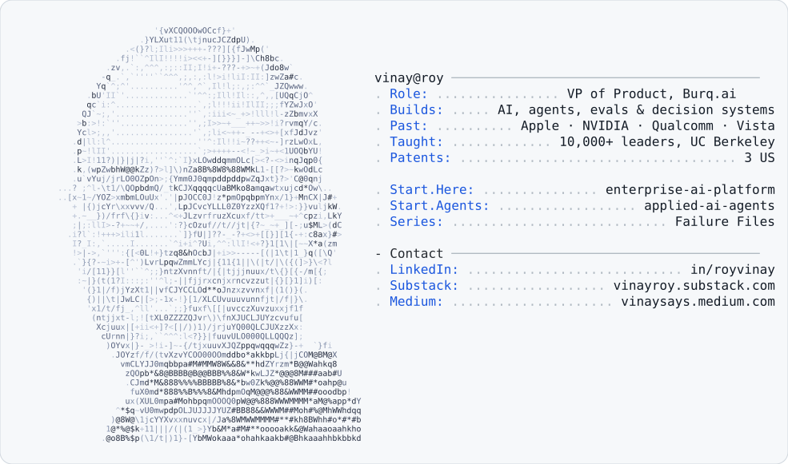

<picture>
  <source media="(prefers-color-scheme: dark)" srcset="cards/banner-dark.svg">
  
</picture>

I'm an AI and product leader. I build, evaluate, and ship AI decision systems across B2B SaaS and marketplaces, and study what transfers between them.

My projects explore what it takes to move AI from demos into production: evaluation, tool use, guardrails, human oversight, and decision quality. Each one starts the same way: a real problem, the smallest version that works, evals on the behavior that matters, and a write-up of the trade-offs.

**▶️ 74-second walkthrough**

https://github.com/user-attachments/assets/59dd167e-04f4-46d6-83a1-887d91a94747

#### Start here

**Build and evaluate**

<a href="https://github.com/roy-vinay/applied-ai-agents"><picture><source media="(prefers-color-scheme: dark)" srcset="cards/applied-ai-agents-dark.svg"></picture></a>
<a href="https://github.com/roy-vinay/enterprise-ai-platform"><picture><source media="(prefers-color-scheme: dark)" srcset="cards/enterprise-ai-platform-dark.svg"></picture></a>

**Decisions and practices**

<a href="https://github.com/roy-vinay/ai-decision-log"><picture><source media="(prefers-color-scheme: dark)" srcset="cards/ai-decision-log-dark.svg"></picture></a>
<a href="https://github.com/roy-vinay/claude-code-team-playbook"><picture><source media="(prefers-color-scheme: dark)" srcset="cards/claude-code-team-playbook-dark.svg"></picture></a>

**Try the tools**

<a href="https://github.com/roy-vinay/mdeditdiff"><picture><source media="(prefers-color-scheme: dark)" srcset="cards/mdeditdiff-dark.svg"></picture></a>
<a href="https://github.com/roy-vinay/applied-ai-agents/tree/main/tools/tech60"><picture><source media="(prefers-color-scheme: dark)" srcset="cards/tech60-dark.svg"></picture></a>

#### Writing

- [When Your Team's Coding Agents Start Stepping on Each Other](https://vinaysays.medium.com/when-your-teams-coding-agents-start-stepping-on-each-other-c6fd4c0f44aa)
- [More Claude Code Sessions Made Me Ship Less. Here's What Fixed It.](https://vinayroy.substack.com/p/more-claude-code-sessions-made-me)
- [Building AI Agents That Survive Production](https://vinaysays.medium.com/building-ai-agents-that-survive-production-5bbb2257ba0a)
- Medium: [vinaysays.medium.com](https://vinaysays.medium.com)
- Substack: [Vinay Roy's Objective Function](https://vinayroy.substack.com)

#### About

VP of Product at [Burq.ai](https://burq.ai), leading Product, Design and AI.

Before Burq, I was the founding product leader at an AI SaaS startup, taking it from zero to product-market fit and building multi-agent systems in production. Before that, I led a global team of about 80 across Product, Data Science and Analytics at Vista, the private aviation group behind VistaJet and XO. 
Earlier: marketplace growth at Zeus Living, macOS and iOS features at Apple (including Sidecar), and engineering teams at Qualcomm and NVIDIA.

For seven years I was Head Instructor for the AI/ML executive program at UC Berkeley Executive Education, teaching more than 10,000 business leaders. 3 US patents, MBA from Berkeley Haas, MS from IIT Roorkee.

San Jose, CA · [LinkedIn](https://www.linkedin.com/in/royvinay)

<picture>
  <source media="(prefers-color-scheme: dark)" srcset="dark_mode.svg">
  
</picture>
