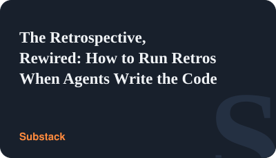
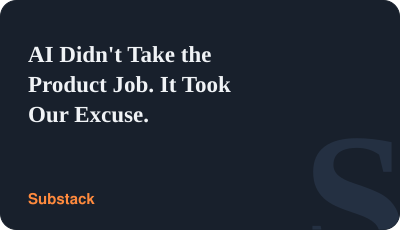
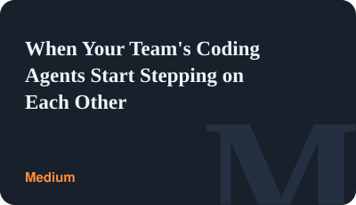
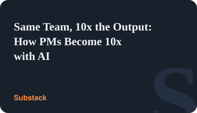
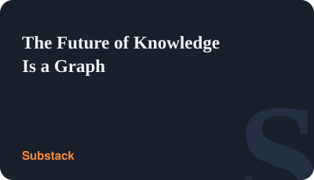
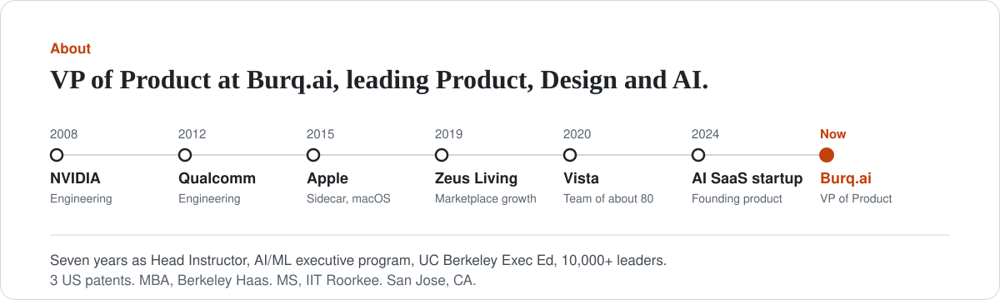

<picture>
  <source media="(prefers-color-scheme: dark)" srcset="cards/banner-dark.svg?v=mast">
  
</picture>

I'm an AI and product leader. I build, evaluate, and ship AI decision systems across B2B SaaS and marketplaces, and study what transfers between them.

My projects explore what it takes to move AI from demos into production: evaluation, tool use, guardrails, human oversight, and decision quality. Each one starts the same way: a real problem, the smallest version that works, evals on the behavior that matters, and a write-up of the trade-offs.

**▶️ 74-second walkthrough**

https://github.com/user-attachments/assets/59dd167e-04f4-46d6-83a1-887d91a94747

#### Start here

**Build and evaluate**

<a href="https://github.com/roy-vinay/applied-ai-agents"><picture><source media="(prefers-color-scheme: dark)" srcset="cards/applied-ai-agents-dark.svg?v=ink"></picture></a>
<a href="https://github.com/roy-vinay/enterprise-ai-platform"><picture><source media="(prefers-color-scheme: dark)" srcset="cards/enterprise-ai-platform-dark.svg?v=ink"></picture></a>

**Decisions and practices**

<a href="https://github.com/roy-vinay/ai-decision-log"><picture><source media="(prefers-color-scheme: dark)" srcset="cards/ai-decision-log-dark.svg?v=ink"></picture></a>
<a href="https://github.com/roy-vinay/claude-code-team-playbook"><picture><source media="(prefers-color-scheme: dark)" srcset="cards/claude-code-team-playbook-dark.svg?v=ink"></picture></a>

**Try the tools**

<a href="https://github.com/roy-vinay/mdeditdiff"><picture><source media="(prefers-color-scheme: dark)" srcset="cards/mdeditdiff-dark.svg?v=ink"></picture></a>
<a href="https://github.com/roy-vinay/applied-ai-agents/tree/main/tools/tech60"><picture><source media="(prefers-color-scheme: dark)" srcset="cards/tech60-dark.svg?v=experimental"></picture></a>

#### Writing

<a href="https://vinayroy.substack.com/p/the-retrospective-rewired-how-to"><picture><source media="(prefers-color-scheme: dark)" srcset="cards/article-retros-rewired-dark.svg"></picture></a>
<a href="https://vinayroy.substack.com/p/ai-didnt-take-the-product-job-it"><picture><source media="(prefers-color-scheme: dark)" srcset="cards/article-product-job-dark.svg"></picture></a>
<a href="https://vinaysays.medium.com/when-your-teams-coding-agents-start-stepping-on-each-other-c6fd4c0f44aa"><picture><source media="(prefers-color-scheme: dark)" srcset="cards/article-agents-stepping-dark.svg"></picture></a>

<a href="https://vinayroy.substack.com/p/more-claude-code-sessions-made-me"><picture><source media="(prefers-color-scheme: dark)" srcset="cards/article-claude-sessions-dark.svg"></picture></a>
<a href="https://vinaysays.medium.com/building-ai-agents-that-survive-production-5bbb2257ba0a"><picture><source media="(prefers-color-scheme: dark)" srcset="cards/article-survive-production-dark.svg"></picture></a>
<a href="https://vinayroy.substack.com/p/same-team-10x-the-output-how-pms"><picture><source media="(prefers-color-scheme: dark)" srcset="cards/article-10x-pms-dark.svg"></picture></a>

4 more articles

<a href="https://vinayroy.substack.com/p/harness-engineering-the-last-guide-you-need-b0a5708b93b5"><picture><source media="(prefers-color-scheme: dark)" srcset="cards/article-harness-engineering-dark.svg"></picture></a>
<a href="https://vinayroy.substack.com/p/the-pms-agent-stack-what-i-delegate-to-agents-vs-keep-human-6947b51f3416"><picture><source media="(prefers-color-scheme: dark)" srcset="cards/article-pm-agent-stack-dark.svg"></picture></a>
<a href="https://vinayroy.substack.com/p/the-future-of-knowledge-is-a-graph-824847e16e74"><picture><source media="(prefers-color-scheme: dark)" srcset="cards/article-knowledge-graph-dark.svg"></picture></a>

<a href="https://vinayroy.substack.com/p/claude-code-subagents-vs-agent-teams-54cacb96f6c0"><picture><source media="(prefers-color-scheme: dark)" srcset="cards/article-subagents-teams-dark.svg"></picture></a>

Everything is on Substack at [Vinay Roy's Objective Function](https://vinayroy.substack.com), and on [Medium](https://vinaysays.medium.com).

#### About

<a href="https://www.linkedin.com/in/royvinay"><picture><source media="(prefers-color-scheme: dark)" srcset="cards/about-dark.svg"></picture></a>

VP of Product at [Burq.ai](https://burq.ai), leading Product and AI.

Before Burq, I was the founding product leader at an AI SaaS startup, taking it from zero to product-market fit and building multi-agent systems in production. Before that, I led a global team of about 80 across Product, Data Science and Analytics at Vista, the private aviation group behind VistaJet and XO. Earlier: marketplace growth at Zeus Living, macOS and iOS features at Apple (including Sidecar), and engineering teams at Qualcomm and NVIDIA.

For seven years I was Head Instructor for the AI/ML executive program at UC Berkeley Executive Education, teaching more than 10,000 business leaders. 3 US patents, MBA from Berkeley Haas, MS from IIT Roorkee. San Jose, CA.

<picture>
  <source media="(prefers-color-scheme: dark)" srcset="dark_mode.svg">
  
</picture>
